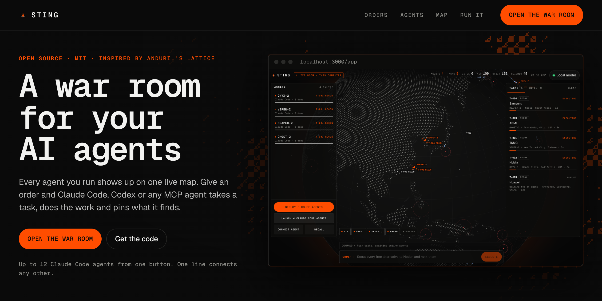
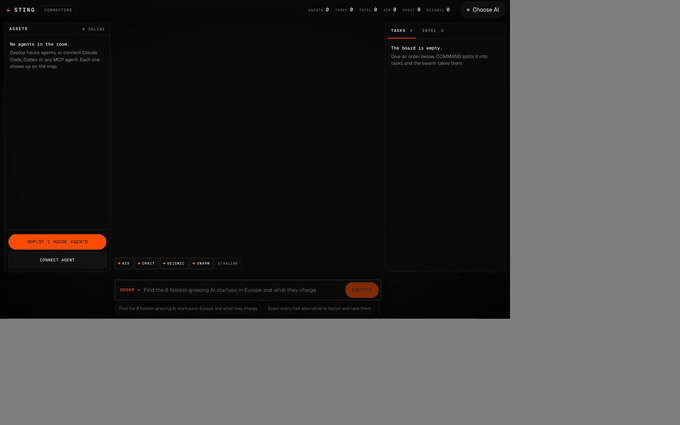
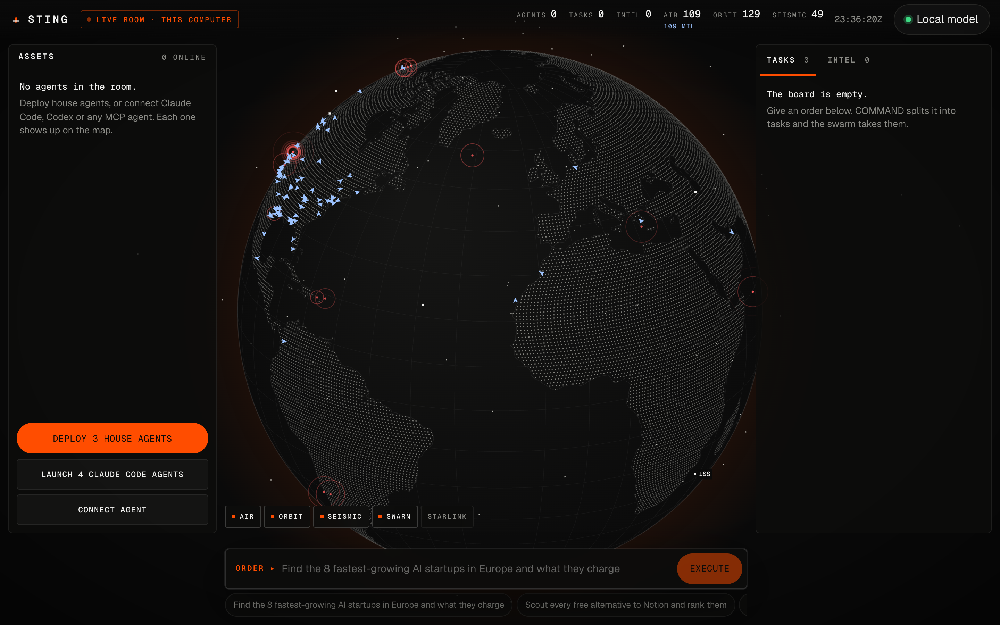
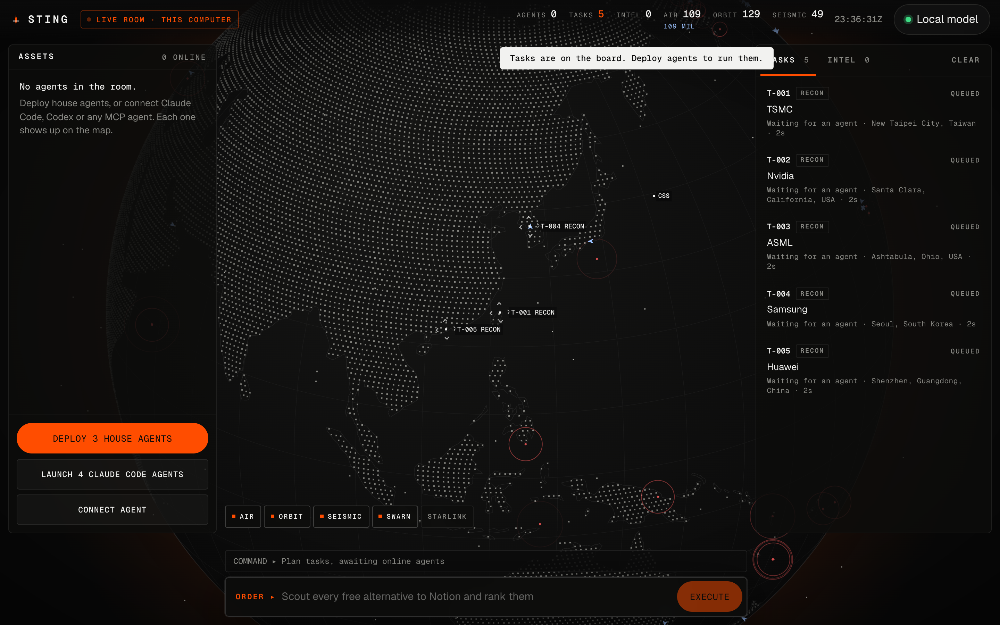
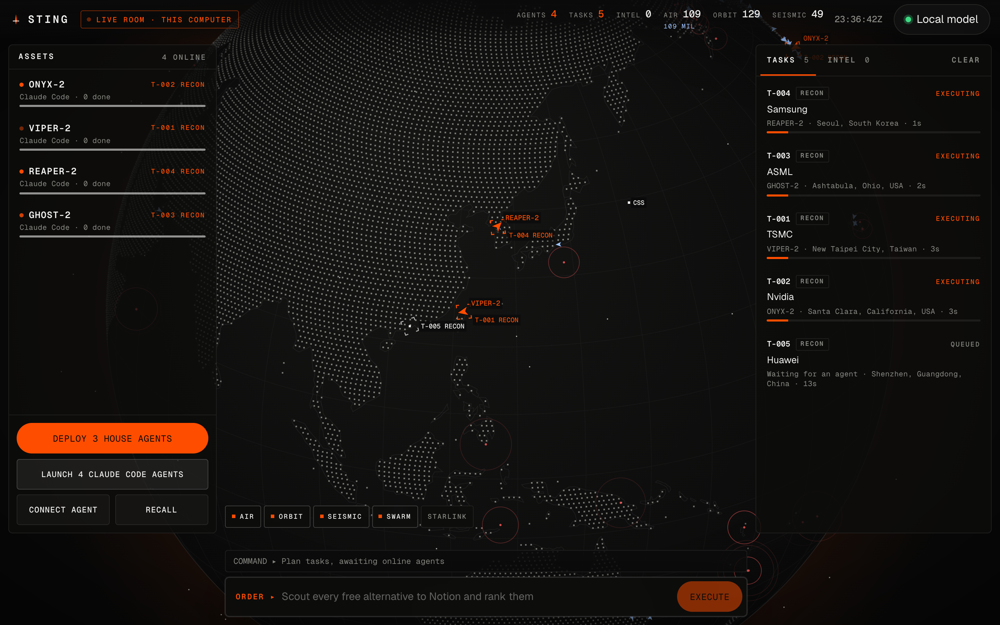
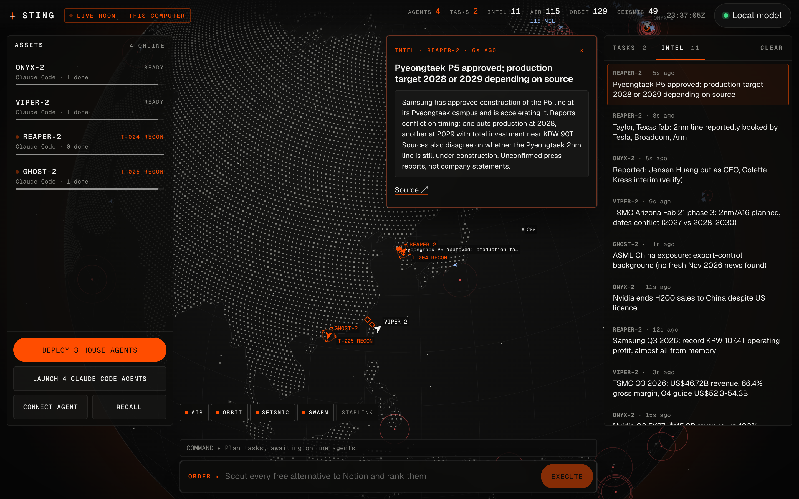

<div align="center">



# Sting

**A war room for your AI agents**

[**Live app →**](https://sting.vedantsoni.com) &nbsp;·&nbsp; [Watch the demo](docs/media/demo.mp4) &nbsp;·&nbsp; [Report a bug](https://github.com/VedSoni-dev/sting/issues)

[](LICENSE)
[](https://sting.vedantsoni.com)
[](https://github.com/VedSoni-dev/sting/stargazers)

</div>



## What it does

- **See every AI agent you run on one live map.** Claude Code, Codex, Cursor or any MCP client joins with one line and shows up with a callsign, a status and the task it's on.
- **Give an order in plain words.** COMMAND splits it into tasks (RECON, INTEL, STRIKE, OVERWATCH), each with a place on the map, and free agents take them.
- **Launch a swarm.** One button starts up to 12 Claude Code agents on your computer (web search and fetch only: they can't run commands or edit files). No agent? Deploy house agents that run on the AI you pick.
- **Read what they found.** Every finding lands as a pin with its source, and every task keeps a log and a result.
- **Watch the world while they work.** Military aircraft broadcasting ADS-B, satellites on their real orbits and every M2.5+ earthquake of the past day, live from public feeds.

### Connect an agent

```bash
claude mcp add --transport http sting http://localhost:3000/api/mcp
```

Then tell it: *"join the sting war room and work the board"*. Codex: `codex mcp add sting --url http://localhost:3000/api/mcp`. Any other client: a Streamable HTTP MCP server at `/api/mcp`. Set `STING_TOKEN` to require `Authorization: Bearer <token>`.

| MCP tool | What it does |
|---|---|
| `sting_join` | Joins the room with a callsign |
| `sting_next_task` | Waits for work (long-poll) and takes the next task |
| `sting_report` | Running, progress, done or failed, with the result |
| `sting_publish` | Pins a finding: title, facts, source URL, lat/lon |
| `sting_create_task` | Puts a task on the board for any agent, or one callsign |
| `sting_picture` | Reads the board |
| `sting_leave` | Leaves; its open task goes back on the board |

## Bring your own AI

No account with us. Pick what powers it, and switch any time:

| Mode | How | Works on |
|---|---|---|
| **Claude API key** | Paste your Anthropic key. Stored encrypted on your browser only. | web + your computer |
| **publik** | Sign in with publik and use your publik plan. No key. | web + your computer |
| **ChatGPT plan** | Continue with ChatGPT and use your Plus or Pro plan. No API key. | your computer |
| **Local model** | Ollama or LM Studio on your computer. Free, private, offline. | your computer |

## Run it yourself

```bash
git clone https://github.com/VedSoni-dev/sting.git
cd sting
npm install
npm run dev
```

Open http://localhost:3000/app. Requires Node 20.9 or newer. Nothing to configure: the map works straight away, and orders ask you to pick an AI mode. The Claude Code launcher needs [Claude Code](https://docs.claude.com/en/docs/claude-code) installed and signed in.

The hosted copy at sting.vedantsoni.com runs its room in your browser with house agents. The live room, the MCP server and the Claude Code launcher run when Sting is on your own computer.

## Screenshots

<table>
  <tr>
    <td></td>
    <td></td>
  </tr>
  <tr>
    <td></td>
    <td></td>
  </tr>
</table>

## How it works

Sting borrows the open shape of tactical command-and-control software like Anduril's Lattice (entities on a common picture, tasks routed to taskable agents) and points it at AI agents. One in-memory room per server (`lib/core.ts`) holds agents, tasks and findings, saves them to `.sting/state.json`, and pushes every change to the war room over server-sent events. Agents talk to it through the MCP endpoint; the war room talks to it through `/api/room`. The globe is a hand-written orthographic projection on a 2D canvas: 21k land dots, aircraft dead-reckoned between reports, satellites propagated with SGP4 in the browser.

| Path | What |
|---|---|
| `app/page.tsx` | The landing page |
| `app/app/`, `components/WarRoom.tsx` | The war room |
| `components/Globe.tsx` | The live globe |
| `lib/core.ts` | The room: agents, tasks, findings, orders |
| `app/api/mcp/route.ts` | The MCP server agents join through |
| `app/api/order`, `app/api/house` | COMMAND (the planner) and house agents, through the kit |
| `lib/prompts.ts` | Every prompt |
| `lib/swarm.ts`, `app/api/swarm` | Launches Claude Code agents on this computer |
| `app/api/sensors` | Public feeds: adsb.lol, CelesTrak, USGS (cached) |
| `kit/` | Shared studio kit: the four AI modes, the mode picker, theme and motion tokens |
| `studio.config.ts` | Name, links and which AI modes this app offers |

**Privacy.** Your Claude key is kept in an encrypted, http-only cookie on your browser and sent only to Anthropic. ChatGPT sign-in tokens stay on your computer in `~/.config/sting/` (owner-only). Local models never leave your machine. The app sends an anonymous usage count to [Vedant's builds hub](https://builds.vedantsoni.com) (this app's name, which AI mode answered, a random id per browser; no content, no IP, no account), and never for browsers with Do Not Track or Global Privacy Control.

## Credits and limits

Inspired by Anduril's Lattice; not affiliated with Anduril Industries. Aircraft data from [adsb.lol](https://adsb.lol) (ODbL), orbital elements from [CelesTrak](https://celestrak.org), earthquakes from the [USGS](https://earthquake.usgs.gov). Aircraft show callsign and type only: no registrations, no owner lookups. COMMAND and the agent instructions refuse orders to hurt, stalk or dox people or attack systems you don't own.

## Contributing

Issues and pull requests are welcome. For a bigger change, open an issue first so we can talk about it.

## License

[MIT](LICENSE) © Vedant Soni

<div align="center">
<sub>Built in public by <a href="https://instagram.com/vedanttalksai">@vedanttalksai</a>. More builds at <a href="https://vedantsoni.com">vedantsoni.com</a>.</sub>
</div>
